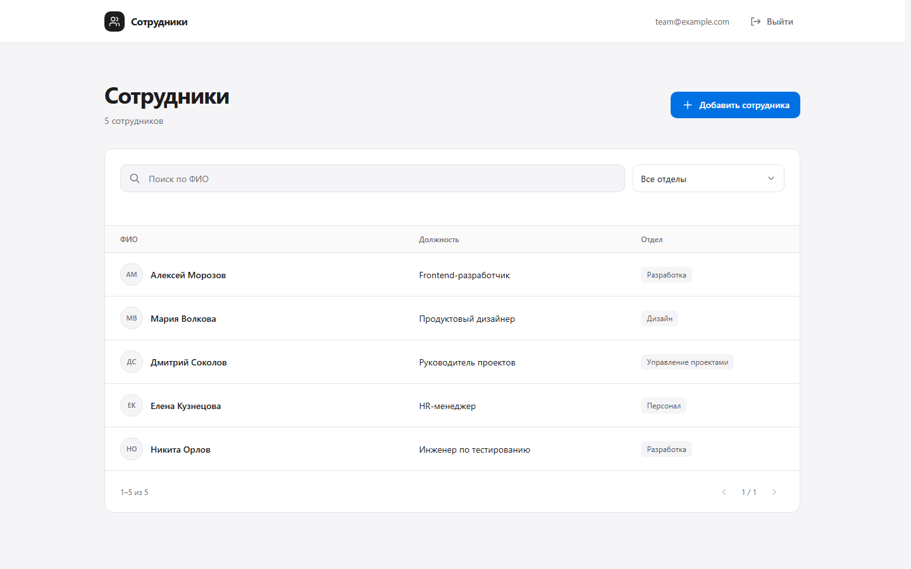

# Сотрудники

Корпоративный справочник с авторизацией, поиском по ФИО, фильтрацией по отделу и добавлением сотрудников.



## Возможности

- Регистрация, вход и выход с серверными сессиями в HttpOnly cookie.
- Поиск по ФИО без учёта регистра с поддержкой кириллицы и задержкой 300 мс.
- Совместная работа поиска, фильтра отдела и пагинации.
- Добавление сотрудника с клиентской и серверной валидацией.
- Автоматическое обновление списка через RTK Query после сохранения.
- Сохранение данных в SQLite и однократное добавление пяти демонстрационных сотрудников.
- Адаптивный интерфейс: таблица на больших экранах, вертикальный список на мобильных.
- Управление с клавиатуры, доступные формы и поддержка reduced-motion.

## Стек

| Часть            | Технологии                           |
| ---------------- | ------------------------------------ |
| Frontend         | React, TypeScript, React Router      |
| Серверные данные | Redux Toolkit, RTK Query             |
| Интерфейс        | Обычный CSS, БЭМ, Radix Select       |
| Backend          | Node.js, Express, TypeScript         |
| Хранение         | SQLite                               |
| Валидация        | Zod                                  |
| Проверки         | node:test, Playwright, axe, Prettier |
| Сборка           | Vite, TypeScript                     |

## Быстрый запуск

Требуются **Node.js 22.13+ из ветки 22 LTS**, npm и Git.

```sh
git clone https://github.com/CrutoiChell/employee-directory.git
cd employee-directory
npm ci
npm run dev
```

Приложение: **http://127.0.0.1:5173**

Создайте аккаунт на странице регистрации. Готовой учётной записи и встроенного пароля нет. SQLite создаётся автоматически в `data/directory.sqlite`. При первом запуске появляются пять демо-сотрудников; повторные запуски не дублируют их.

Vite проксирует `/api` на сервер с портом 3001. Если один из портов занят, остановите предыдущий процесс приложения.

## Сборка и запуск

```sh
npm run build
npm start
```

Адрес: **http://127.0.0.1:3001**

Сборка создаёт `dist/` для frontend и `dist-server/` для backend. Команда `npm start` запускает собранный JavaScript сервера.

В Node.js 22 модуль `node:sqlite` экспериментальный. Необходимый флаг уже включён в скрипты запуска.

## Проверки

```sh
npm run typecheck
npm test
npm run build
npm run format:check
```

Браузерные проверки:

```sh
npx playwright install chromium
npm run test:e2e
```

Проверяются регистрация, вход и выход, защита API, серверная валидация, поиск и фильтрация, обновление списка после добавления, пагинация и сохранение SQLite после перезапуска отдельного процесса.

Браузерные сценарии покрывают 375, 768 и 1440 px, клавиатуру и касания, состояния форм, debounce, reduced-motion и доступность. Select проверяется с длинным списком и обычной полосой прокрутки. Для открытого popup axe проверяет активный компонент; для закрытого состояния — страницу.

Тесты используют временные базы и отдельную SQLite в памяти. Рабочая база не очищается.

## Структура проекта

```text
client/src/
  App/             Redux store и RTK Query API
  Routes/          Login, Registration, Employees
  Components/      Header, список, фильтры, формы, Select
  types/           Типы ответов API
  App.tsx          Маршруты приложения
  index.css        Общие токены и базовые стили
  main.tsx         Точка входа и Provider

server/
  routes/          Авторизация и сотрудники
  middleware/      Проверка сессии, Origin и ошибок
  db/              SQLite и однократный seed
  utils/           Работа с сессиями
  app.ts           Конфигурация Express
  index.ts         Запуск сервера

shared/            Общие Zod-схемы и типы
tests/             API, RTK Query и браузерные тесты
```

CSS расположен рядом с компонентами. Login и Registration используют общую AuthForm. Локальное состояние полей, фильтров и модального окна остаётся в React; Redux содержит только API reducer и middleware RTK Query.

## API

| Метод | Путь                 | Назначение                      |
| ----- | -------------------- | ------------------------------- |
| POST  | `/api/auth/register` | Регистрация                     |
| POST  | `/api/auth/login`    | Вход                            |
| POST  | `/api/auth/logout`   | Завершение сессии               |
| GET   | `/api/auth/me`       | Текущий пользователь            |
| GET   | `/api/employees`     | Список, поиск, отдел и страница |
| POST  | `/api/employees`     | Добавление сотрудника           |

Справочник доступен только после входа. Для списка используются параметры `search`, `department`, `page`; размер страницы — 10 записей.

## Безопасность и данные

- Пароли хешируются scrypt с индивидуальной случайной солью.
- В базе хранится SHA-256 сессионного токена и срок действия; в браузере — HttpOnly cookie с SameSite=Lax.
- После выхода сессия удаляется на сервере, а RTK Query очищает пользовательский кэш.
- Изменяющие запросы требуют JSON и проходят проверку Origin.
- SQLite-запросы параметризованы, поля проверяются сервером.
- Используются Helmet, ограничение запросов авторизации и лимит размера JSON.
- Пароли и токены не сохраняются в localStorage или Redux.
- SQLite, `.env`, зависимости, сборки и локальные материалы исключены из Git.

## Конфигурация и ограничения

| Переменная окружения | Значение по умолчанию   | Назначение                            |
| -------------------- | ----------------------- | ------------------------------------- |
| `PORT`               | `3001`                  | Порт сервера                          |
| `DATABASE_PATH`      | `data/directory.sqlite` | Путь к базе                           |
| `APP_ORIGIN`         | Origin текущего запроса | Разрешённый публичный origin          |
| `NODE_ENV`           | Не задана               | В `production` включает Secure cookie |

Переменные задаются окружением процесса; автоматическая загрузка `.env` не подключена. Для внешнего развёртывания нужны HTTPS, reverse proxy и точный `APP_ORIGIN`. Production-cookie с флагом Secure не работает через обычный HTTP. Сервер слушает loopback.

Все зарегистрированные пользователи имеют одинаковый доступ к общему справочнику. Ролей, организаций, восстановления пароля, подтверждения email, редактирования и удаления нет.

Поиск кириллицы выполняется на сервере в памяти после чтения SQLite. Для большого справочника потребуется индексированный поиск и пагинация на уровне SQL. Деплой и реальные мобильные устройства не входят в выполненные проверки.
